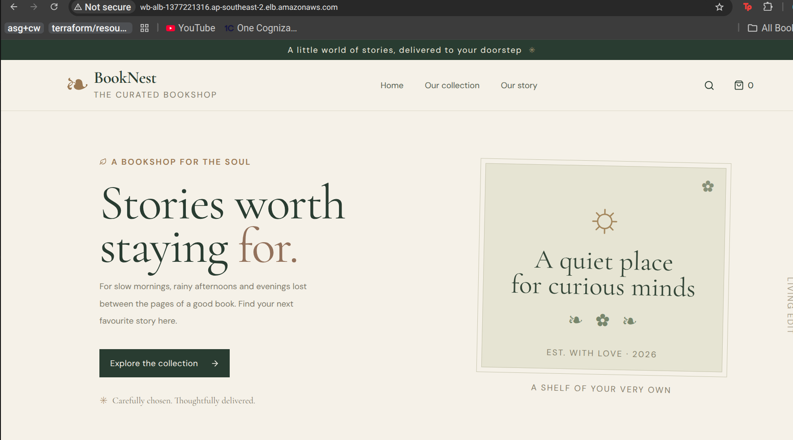
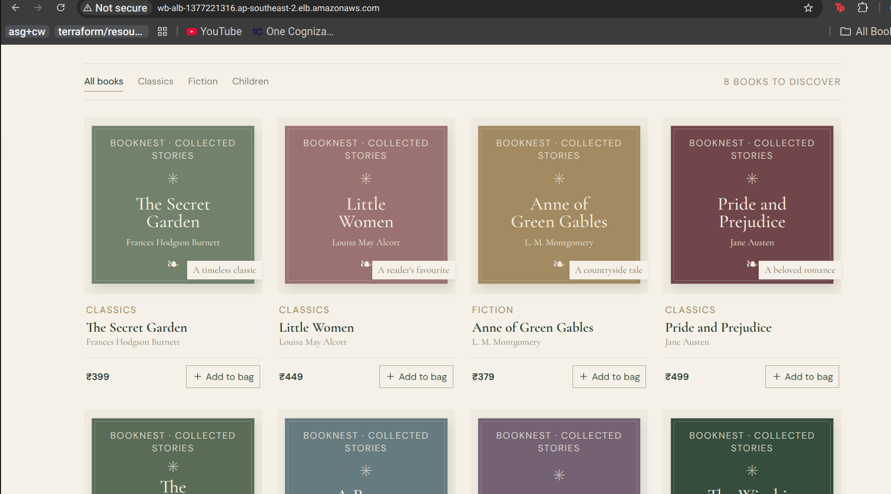
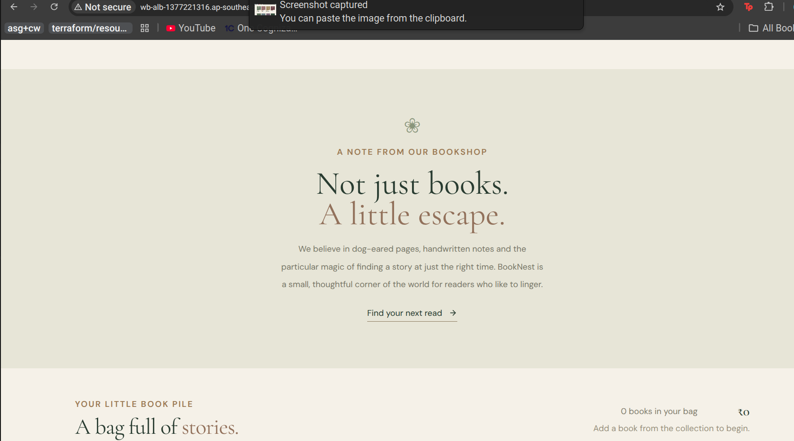
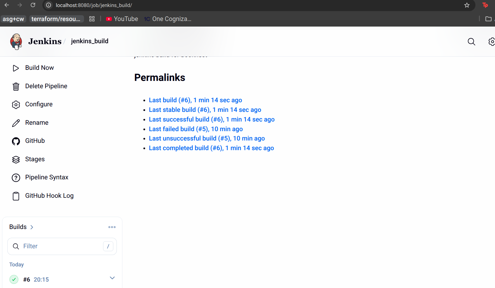
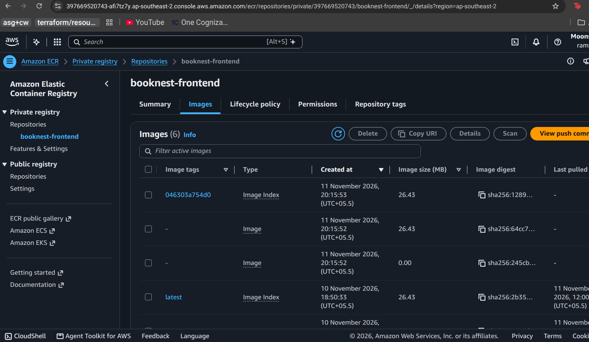
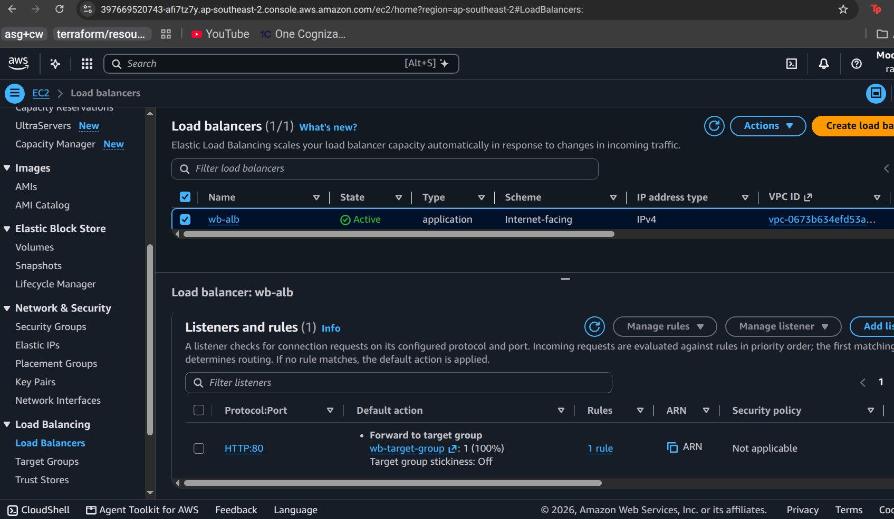
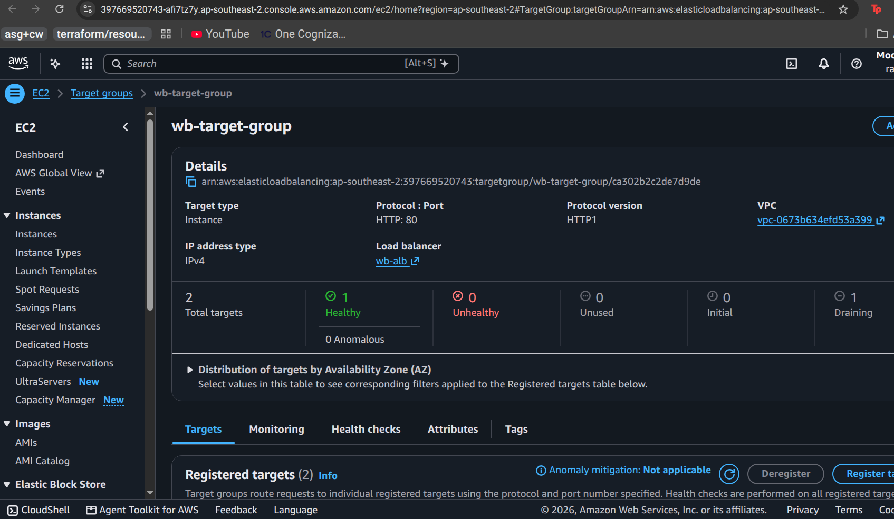

# Varnam – Cloud-Native Bookstore Deployment on AWS

**Automating Application Delivery with Terraform, Docker, Jenkins and AWS**





## Overview

Varnam is a cloud-native bookstore application deployed on AWS using Infrastructure as Code and CI/CD automation.

The application consists of a React frontend, FastAPI backend and PostgreSQL database. Docker is used to containerize the application, while Terraform provisions the AWS infrastructure.

Jenkins is integrated with GitHub using webhooks to automate Docker image builds and push application images to Amazon ECR.

## Technology Stack

| Component | Technology |
|---|---|
| Frontend | React, Vite |
| Backend | Python, FastAPI |
| Database | PostgreSQL |
| Containerization | Docker |
| CI/CD | Jenkins |
| Source Control | Git, GitHub |
| Container Registry | Amazon ECR |
| Compute | Amazon EC2 |
| Load Balancing | Application Load Balancer |
| Auto Scaling | EC2 Auto Scaling Group |
| Database Hosting | Amazon RDS |
| Infrastructure as Code | Terraform |
| Region | ap-southeast-2 (Sydney) |

## Architecture

```text
                 Internet
                    |
                    v
         Application Load Balancer
                    |
                    v
              EC2 Instances
                    |
          +---------+---------+
          |                   |
          v                   v
    Frontend Container  Backend Container
        (Nginx)             (FastAPI)
          |                   |
          +---------+---------+
                    |
                    v
               PostgreSQL
                  (RDS)
```

## Project Structure

```text
varnam/
├── frontend/
│   ├── src/
│   ├── Dockerfile
│   ├── nginx.conf
│   └── package.json
│
├── backend/
│   ├── main.py
│   ├── requirements.txt
│   └── Dockerfile
│
└── infrastructure/
    └── main.tf
```

## AWS Infrastructure – Terraform

Terraform provisions:

- VPC, public and private subnets.
- Internet Gateway and route tables.
- Application Load Balancer.
- EC2 instances and Auto Scaling Group.
- Security groups.
- Amazon RDS for PostgreSQL.
- Amazon ECR repositories.
- IAM roles.

## CI/CD Pipeline – Jenkins

GitHub is integrated with Jenkins using webhooks.

### GitHub Webhook Configuration

1. Configure the GitHub repository in Jenkins.
2. Enable `GitHub hook trigger for GITScm polling` in Jenkins Build Triggers.
3. Add the Jenkins endpoint in GitHub → Settings → Webhooks:

   `https://<JENKINS_SERVER>/github-webhook/`

4. Select `application/json`.
5. Select `Just the push event`.

**Why webhooks?**
- Automatically trigger Jenkins builds on GitHub push events.
- Eliminate manual build triggers.
- Avoid periodic repository polling.
- Enable faster CI feedback.

### Jenkins Pipeline Stages

| Stage | Operation |
|---|---|
| Checkout | Checkout source code from GitHub |
| Build Images | Build frontend and backend Docker images |
| Push to ECR | Authenticate with AWS, tag and push images |

### Pipeline Execution Flow

1. Developer pushes changes to GitHub.
2. GitHub webhook triggers Jenkins.
3. Jenkins checks out the latest code.
4. Generates an image tag using the Git commit hash.
5. Builds frontend and backend Docker images.
6. Retrieves AWS credentials from Jenkins Credentials using the AWS Credentials plugin.
7. Authenticates with AWS using STS.
8. Logs in to Amazon ECR.
9. Tags and pushes both images to ECR.



### AWS Authentication

AWS credentials are stored securely in Jenkins and injected using `withCredentials`.

```groovy
withCredentials([[
    $class: 'AmazonWebServicesCredentialsBinding',
    credentialsId: 'aws'
]]) {
    sh '''
        aws sts get-caller-identity
    '''
}
```

### ECR Authentication

```bash
ACCOUNT_ID=$(aws sts get-caller-identity \
    --query Account --output text)

REGISTRY="${ACCOUNT_ID}.dkr.ecr.${AWS_REGION}.amazonaws.com"

aws ecr get-login-password --region ${AWS_REGION} |
docker login --username AWS --password-stdin ${REGISTRY}
```

### Push Images to ECR

```bash
docker tag ${FRONTEND_REPO}:${IMAGE_TAG} \
${REGISTRY}/${FRONTEND_REPO}:${IMAGE_TAG}

docker tag ${BACKEND_REPO}:${IMAGE_TAG} \
${REGISTRY}/${BACKEND_REPO}:${IMAGE_TAG}

docker push ${REGISTRY}/${FRONTEND_REPO}:${IMAGE_TAG}

docker push ${REGISTRY}/${BACKEND_REPO}:${IMAGE_TAG}
```



## Container Deployment on EC2

Authenticate using the EC2 instance IAM role and pull the images:

```bash
docker pull <ACCOUNT_ID>.dkr.ecr.ap-southeast-2.amazonaws.com/booknest-frontend:<IMAGE_TAG>

docker pull <ACCOUNT_ID>.dkr.ecr.ap-southeast-2.amazonaws.com/booknest-backend:<IMAGE_TAG>
```
### Successful Deployment of Booknest 




Run the application containers using Docker.

## Security

- Store AWS credentials securely in Jenkins.
- Use IAM roles for EC2 access to AWS services.
- Restrict access using security groups.
- Keep RDS in private subnets.
- Avoid hardcoding database credentials.
- Use HTTPS for webhook communication.

## Project Objectives

- Provision AWS infrastructure using Terraform.
- Containerize frontend and backend applications.
- Automate image builds using Jenkins.
- Integrate GitHub webhooks for automatic pipeline triggers.
- Push Docker images to Amazon ECR.
- Deploy containers on EC2.
- Implement secure AWS access and network communication.

---

**Cloud:** AWS | **IaC:** Terraform | **CI/CD:** Jenkins | **SCM:** GitHub | **Containers:** Docker | **Registry:** Amazon ECR